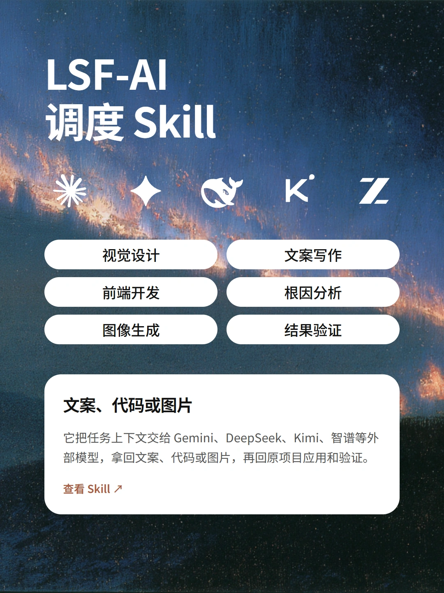

# LSF-AI 调度 Skill

<p align="center">
  
</p>

平时写项目，我会把活分给趁手的模型。重构前先让 Gemini 4 Neon 过一遍方案，写前端和改 bug 找 DeepSeek，做代码视频或强动效就去 Hark 找 Claude Opus 5.5。这个技能把这些用法记下来，省得每次都手动换渠道、再解释一遍项目。

把这个技能装到支持 [SKILL.md](SKILL.md) 的编程助手里，直接说要做什么。助手会整理本轮用得上的材料，发给对应的模型，再把结果带回原项目验证。

## 平时怎么分工

| 任务 | 默认渠道 | 模型与设置 |
|---|---|---|
| 文案和评审 | Antigravity CLI | Gemini 4 Hydrogen / High，额度用完切 AI Studio Hydrogen / High |
| 复杂编程方案 | Antigravity CLI | Gemini 4 Neon / High，[额度用尽时按顺序切换](references/antigravity.md#额度用尽时) |
| 代码视频和强动效 | Hark | Claude Opus 5.5，[新项目优先，普通聊天兜底](references/hark.md) |
| 前端审美与视觉设计 | AI Studio 或 Hark | Gemini 3.1 Pro / High 或 Claude Opus 5.5 |
| 前端实现、常规编码和修复 | DeepSeek | 开启深度思考和智能搜索 |
| 生图和图片编辑 | AI Studio | Nano Banana 2.1，支持 2K / 4K 和指定比例 |
| 指定的设计、文案或综合任务 | Kimi 或智谱 | Kimi K3 或 GLM-5.3，均用极致档 |

点名 Claude 做设计、代码、文案或评审，也走 Hark。同一任务改稿沿用原项目。

## 环境准备

按你要用的功能安装即可。

| 工具 | 什么时候需要 | 下载与安装 |
|---|---|---|
| Git | 用下方的 `git clone` 安装技能 | [下载 Git](https://git-scm.com/downloads/) |
| Antigravity CLI（`agy`） | 走 CLI 的文案、评审或复杂编程。装好后运行 `agy` 登录，再用 `agy models` 查看可用型号 | [CLI 官方安装步骤](https://antigravity.google/docs/getting-started?tab=cli#download-and-install) |
| Ego Lite（含 `ego-browser` 技能） | 让助手操作 AI Studio、Hark 等网页。完成首次设置后，在助手里选用 `ego-browser` | [下载 Ego Lite](https://lite.ego.app/download) · [Windows 安装指南](https://lite.ego.app/document/en/docs/windows/quick-start) |
| Node.js 18+ | 运行本地 JavaScript 脚本或测试，脚本只用 Node.js 内置模块 | [下载 Node.js](https://nodejs.org/en/download) |
| Python 3.10+ | 使用可选的贞贞 API 或运行 Python 测试 | [下载 Python](https://www.python.org/downloads/) |

[AI Studio](https://aistudio.google.com/prompts/new_chat) 和 [Hark](https://hark.com/projects/new) 按需网页登录。你也可以用助手已有的浏览器工具，或让助手准备提示词，自己复制粘贴。

## 安装与使用

把仓库克隆到助手的技能目录，保留仓库内的文件结构。

```powershell
git clone https://github.com/leishifu666/lsf-ai-agent.git "$HOME/.agents/skills/lsf-ai-agent"
```

Codex 也可以放在 `$HOME/.codex/skills/lsf-ai-agent`。本地如果已经改过旧版本，先克隆到别的目录对比，别直接覆盖。装好后刷新技能或新开对话，就可以这样用。

```text
使用 $lsf-ai-agent，让 Gemini 4 Neon 给出当前项目的重构方案。
使用 $lsf-ai-agent，这次我复制粘贴中转，请给我一份完整的 Gemini 交接提示。
使用 $lsf-ai-agent，在 AI Studio 生成 16:9、2K 的图片。
```

### 贞贞 API（可选）

只在你明确要求走贞贞 API 时启用。需自备账号和密钥。Windows 可以在仓库根目录运行以下命令，输入时密钥会隐藏。

```powershell
python -B -X utf8 scripts/credential_store.py --set
python -B -X utf8 scripts/credential_store.py --status
```

其他系统在当前进程里设置 `T8STAR_API_KEY` 环境变量，仓库里不存密钥。详情看 [API 契约](references/runtime.md)。

## 本地验证

改了脚本或路由，可以在仓库根目录跑离线检查。

```powershell
node --test scripts/tests/browser_policy.test.mjs scripts/tests/gemini_browser.test.mjs
python -B -X utf8 -m unittest discover -s scripts/tests -v
python -B -X utf8 scripts/gemini_agent.py route --task design
```

## 许可证

[MIT](LICENSE)。外部网站、浏览器工具和模型服务各自遵循它们自己的使用条款。
