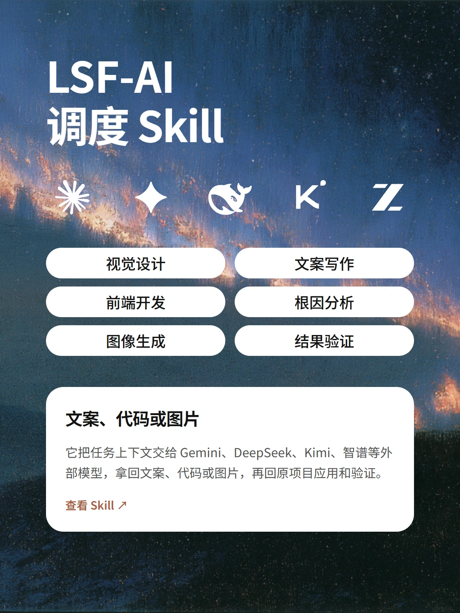

# LSF-AI 调度 Skill

<p align="center">
  
</p>

把任务交给适合的外部模型，收回结果，再回到原项目完成应用和验证。适用于能够加载 `SKILL.md` 的 AI 编程助手；仓库提供任务规则、浏览器页面辅助和可选的 Gemini API 客户端。

## 支持范围

| 任务 | 默认渠道 | 配置 |
|---|---|---|
| 视觉设计、文案 | Google AI Studio | Gemini 3.1 Pro / High |
| 前端、编码、复杂工程 | DeepSeek 网页 | 深度思考＋智能搜索 |
| 明确选择的快速文案、问答 | Google AI Studio | Gemini 3.8 Flash / High |
| 可选的设计、文案、综合任务 | Kimi / 智谱清言 | K3 / 极致；GLM-5.3 / 极致 |
| 图片生成与编辑 | Google AI Studio | Nano Banana 2.1，2K / 4K，明确比例 |

支持三种工作方式：**浏览器操作、用户复制粘贴中转、明确选择的贞贞 API**。沿用当前已选方式，不因故障静默换模型或渠道。Midjourney 只提供人工交接材料；普通 Gemini 网页在此配置中禁用。视频、动效没有独立默认渠道。

这些型号和设置是技能预设，使用时必须核对实际可用项；模型自述、发送成功、思考状态和预览图都不算已完成的交付。页面选择器来自既有适配，网站改版后可能需要更新。

## 安装

将整个仓库克隆到助手的技能目录，保留 `SKILL.md`、`agents/`、`references/`、`scripts/` 的相对结构。例如支持 `~/.agents/skills` 的环境：

```powershell
git clone https://github.com/leishifu666/lsf-ai-agent.git "$HOME/.agents/skills/lsf-ai-agent"
```

Codex 也可将目标目录改成 `$HOME/.codex/skills/lsf-ai-agent`。若目录中已有本地定制版本，先另选目录比较，不覆盖原安装。按宿主要求刷新技能或开始新对话，然后调用：

```text
使用 $lsf-ai-agent，让 DeepSeek 检查当前项目的根因修复方案。
使用 $lsf-ai-agent，这次我复制粘贴中转，请给我一份完整的 Gemini 交接提示。
使用 $lsf-ai-agent，在 AI Studio 生成 16:9、2K 的图片。
```

## 依赖与配置

- **阅读规则、用户中转**：支持加载技能的 AI 助手即可。
- **浏览器模式**：另行安装 Ego Lite 与对应 `ego-browser` 技能，或使用宿主明确支持的浏览器工具。页面辅助模块需要外部传入兼容的 Page，不负责启动浏览器；宿主未提供相关工具时使用中转。
- **JavaScript 模块与离线测试**：Node.js 18+，使用内置模块，无 npm 依赖。
- **可选 API 客户端**：Python 3.10+，仅标准库；端点固定为 `https://ai.t8star.org/v1`。需使用者自己的账号、密钥与额度，只有明确选择 API 后才使用。

仓库不包含账号、Cookie、密钥或本机代理配置。Windows 可从技能根目录运行以下命令，以隐藏输入保存自己的 API 密钥：

```powershell
python -B -X utf8 scripts/credential_store.py --set
python -B -X utf8 scripts/credential_store.py --status
```

其他平台通过当前进程的 `T8STAR_API_KEY` 提供凭据，不保存到仓库。完整使用说明见 [API 契约](references/runtime.md)。

## 本地验证

从仓库根目录执行以下命令；测试使用离线夹具，不发起真实模型任务：

```powershell
node --test scripts/tests/browser_policy.test.mjs scripts/tests/gemini_browser.test.mjs
python -B -X utf8 -m unittest discover -s scripts/tests -v
python -B -X utf8 scripts/gemini_agent.py route --task design
```

覆盖任务路由、允许的渠道集合、图片规格、回答身份和完成状态、会话历史、附件边界与凭据保护。离线通过不代表真实账号、浏览器登录、网络检索或上游模型生成已验证。

## 目录

```text
SKILL.md                 技能规则与任务分工
agents/openai.yaml       助手显示信息与默认提示
references/              各产品、浏览器、API 与恢复说明
scripts/browser_policy.mjs       本地渠道与图片策略
scripts/aistudio_browser.mjs     AI Studio 页面辅助
scripts/deepseek_browser.mjs     DeepSeek 页面辅助
scripts/gemini_agent.py          可选 API 客户端与内存 worker
scripts/credential_store.py      Windows 凭据入口
scripts/gemini_browser.mjs       旧入口禁用保护及公共检查
scripts/tests/                   离线测试
```

## 许可证

[MIT](LICENSE)。第三方网站、浏览器工具和模型服务不包含在本许可证授权范围内，使用时遵循各自的条件。
